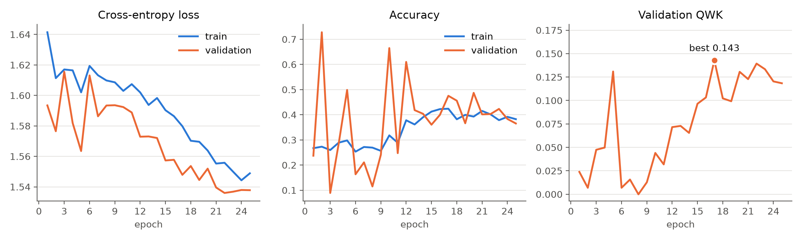
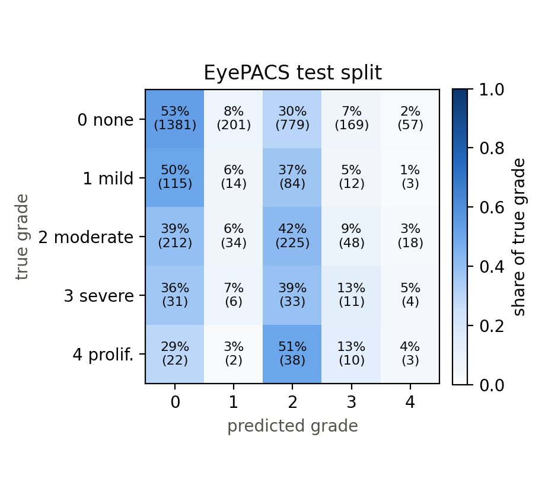
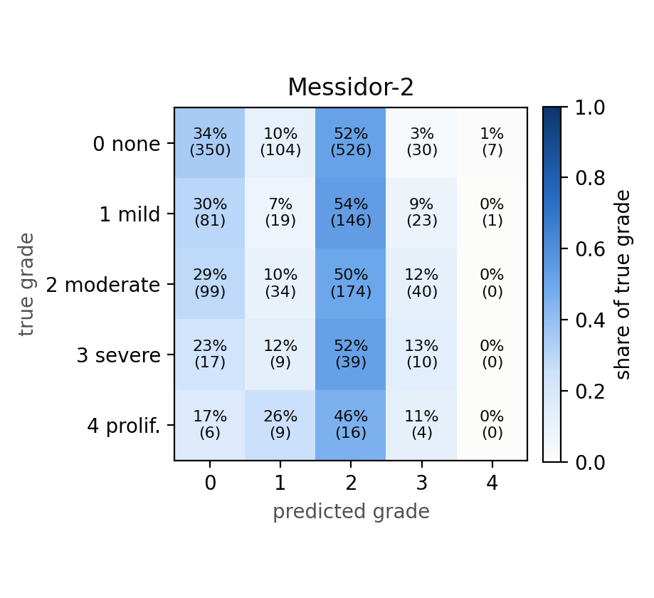

# Vision Mamba for Diabetic Retinopathy Grading

A from-scratch PyTorch implementation of **Vision Mamba (Vim)**
([Zhu et al., ICML 2024](https://arxiv.org/abs/2401.09417)), trained to grade
diabetic retinopathy (grades 0 to 4) from retinal fundus photographs.

The model is trained on **EyePACS** and tested on a held-out, patient-disjoint
EyePACS split and on **Messidor-2**, a separate dataset from a different camera and
country that is never used for training.

No `mamba_ssm`, `timm` or existing Vim code and no pretrained weights are used. The
selective scan, the bidirectional block, the datasets, the training loop and all the
metrics are written by hand. Each file names the section, equation or line of
Algorithm 1 in the paper that it implements.

<p align="center">
  
</p>

## Results

Trained for 25 epochs on a single Kaggle T4 (about 9 min per epoch). The checkpoint
with the best validation QWK (epoch 17) was evaluated once on each test set.

| | EyePACS test | Messidor-2 |
|---|:---:|:---:|
| Images | 3,512 | 1,744 |
| **Quadratic weighted kappa** | **0.119** | **0.083** |
| QWK 95% bootstrap CI | [0.090, 0.149] | [0.045, 0.124] |
| Accuracy | 0.465 | 0.317 |
| Macro precision | 0.222 | 0.206 |
| Macro recall | 0.237 | 0.210 |
| Macro F1 | 0.212 | 0.184 |
| Recall, grades 0 / 1 / 2 / 3 / 4 | 0.53 / 0.06 / 0.42 / 0.13 / 0.04 | 0.34 / 0.07 / 0.50 / 0.13 / 0.00 |

<p align="center">
  
  
</p>

Notes on the results:

- **The scores are low.** The model is trained from scratch at 128 px for 25 epochs,
  compared with ImageNet pretraining, 224 px and 300 epochs in the paper. Both losses
  were still falling when training stopped, so longer training should help.
- **Messidor-2 shows a domain-shift drop.** QWK falls from 0.119 to 0.083, and the
  model over-calls grade 2 on the new camera (52% of predictions).
- **Preprocessing matters a lot.** On a contrast-enhanced copy of Messidor-2 the
  same model predicts grade 0 for every image (QWK 0). Only the original photographs
  give a fair test.
- **Training failed at first without the D skip term.** The first run followed the
  printed Algorithm 1 exactly, with no `D * x` skip term, and did not learn. The
  class token barely depended on the input image, and the loss later went NaN.
  Adding the skip term from the official Mamba code fixed it. It can be turned off
  with `--override model.d_skip=false`.

The full write-up is in [`report/main.tex`](report/main.tex). The raw numbers are in
[`results/`](results).

## Model

| | Paper (Vim-Ti) | Here |
|---|:---:|:---:|
| Input / patch size | 224 / 16 | 128 / 16 |
| Tokens (patches + class token) | 196 + 1 | 64 + 1 |
| D / E / N | 192 / 384 / 16 | 192 / 384 / 16 |
| Blocks | 24 | 12 |
| Class token | middle | middle (index 32) |
| Parameters | ~7M | 6.87M |

The parameter count stays close to Vim-Ti despite half the depth, because the printed
Algorithm 1 uses a full 384 x 384 projection for Δ, where the official code uses a
low-rank one.

```
vim/            the model
  patch_embed.py      image -> 64 patch tokens (Eq. 4)
  tokens.py           middle class token + position embeddings (Eq. 4)
  selective_scan.py   discretisation and the SSM recurrence (Eqs. 1-2)
  vim_block.py        bidirectional Vim block (Algorithm 1)
  vision_mamba.py     full classifier
data/           EyePACS / Messidor-2 datasets, patient-level split, fundus preprocessing
train/          training loop, LR schedule, checkpoints, logging
eval/           metrics (incl. QWK), evaluation, bootstrap CIs, figures
tests/          63 tests (hand-computed scan steps, shapes, gradients, data, metrics)
configs/        every hyperparameter in one YAML file
report/         LaTeX report and figures
results/        training log and final metrics
```

## Running it

```bash
pip install -r requirements.txt
python -m pytest tests -q              # ~30 s on a CPU
python -m train.train --smoke-test     # 2 tiny epochs on synthetic images
```

**Data.** The datasets can't be redistributed, so download them from Kaggle:

- EyePACS: `tanlikesmath/diabetic-retinopathy-resized` (images + `trainLabels.csv`)
- Messidor-2 grades: `google-brain/messidor2-dr-grades` (`messidor_data.csv`)
- Messidor-2 images: `xyaustin/messidor2` (the original photographs)

Put them under `datasets/` as set in `configs/default.yaml`, or pass the paths on the
command line.

**Train and evaluate:**

```bash
python -m train.train
python -m eval.evaluate     # EyePACS test + Messidor-2, writes results.json
python -m eval.plots        # figures into report/figures/
python -m eval.bootstrap    # 95% CIs for QWK from results/results.json
```

Any config value can be overridden without editing the YAML:

```bash
python -m train.train \
  --override data.eyepacs_image_dir=/kaggle/input/.../resized_train \
  --override data.eyepacs_labels_csv=/kaggle/input/.../trainLabels.csv \
  --override train.epochs=25
```

On Kaggle, use a T4 GPU and time one epoch first (`--override train.epochs=1`) to
make sure the run fits in the 12-hour limit.

## Training setup

AdamW (lr 5e-4, weight decay 0.05), 3 warmup epochs, then cosine decay to 1e-5,
batch size 32, gradient clipping at 1.0, and float32. The loss is cross-entropy with
inverse-frequency class weights, since 73% of EyePACS images are grade 0. Augmentation
is limited to flips, rotation of up to ±15° and mild colour jitter. There are no
random crops or erasing, because those can remove the few small lesions that decide
the grade. Data is split by patient (80/10/10), so both eyes of a patient are always
in the same split. A single seed (42) controls everything, and every checkpoint
stores the config it was trained with.

## Reference

```bibtex
@inproceedings{zhu2024vim,
  title     = {Vision Mamba: Efficient Visual Representation Learning with Bidirectional State Space Model},
  author    = {Zhu, Lianghui and Liao, Bencheng and Zhang, Qian and Wang, Xinlong and Liu, Wenyu and Wang, Xinggang},
  booktitle = {International Conference on Machine Learning (ICML)},
  year      = {2024}
}
```
